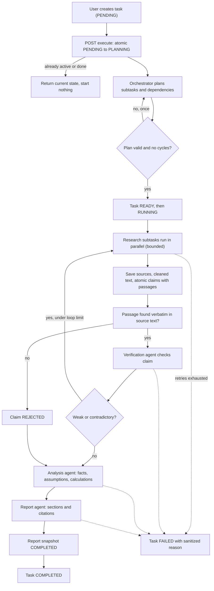
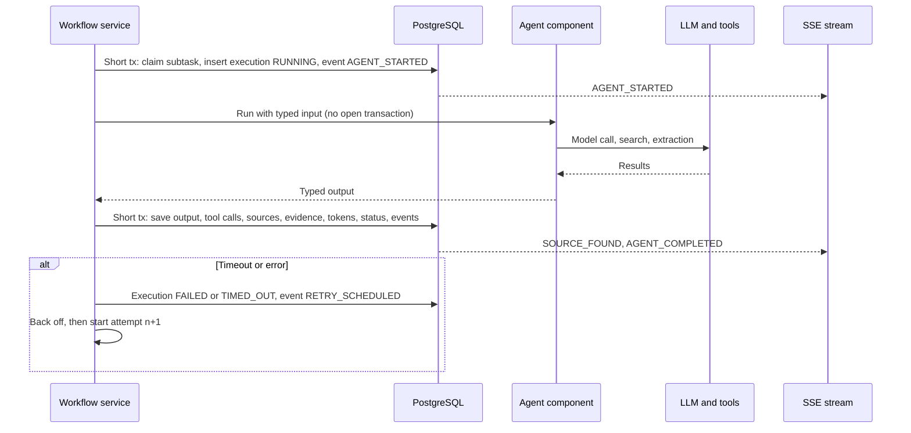
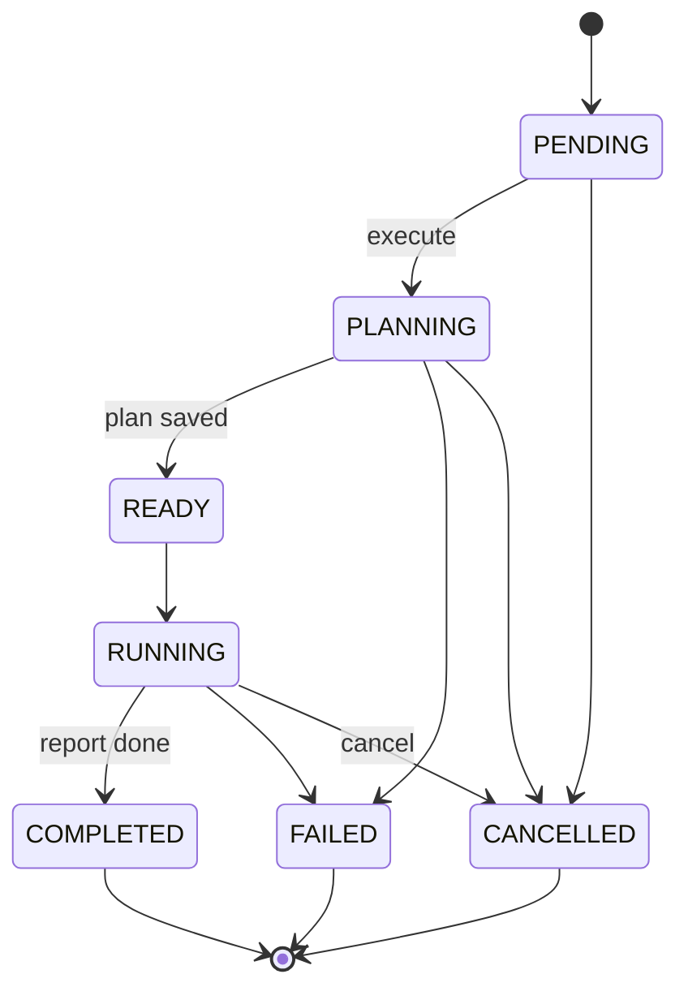
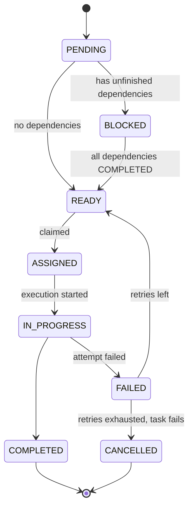
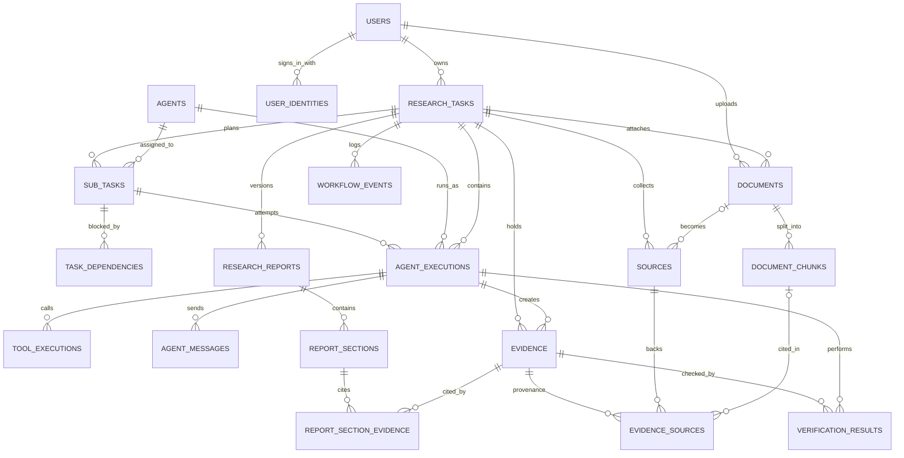

# Nymbus: project context, flow and build plan

Version 1.1 | 31 October 2026 | Hackathon build

Use this file as the single reference for building Nymbus: what it is, how a run flows, how the build is split into phases, and the SQL for each phase.

---

# 1. Context

## What it is

Nymbus is a multi-agent research platform. A user submits a complex research question. The system breaks it into subtasks, assigns them to specialized agents, collects evidence from the web and uploaded documents, verifies each claim against its source passage, and produces a report where every important conclusion traces back to its evidence.

**The differentiator** is not that several agents exist. It is that the platform shows how work was decomposed, which tools ran, what evidence was found, how claims were verified, and which evidence supports each conclusion.

## Stack

| Layer | Choice |
| --- | --- |
| Application | Spring Boot modular monolith (REST, auth, persistence, orchestration, SSE) |
| AI | Spring AI (model access, tool calling, structured output, embeddings) |
| LLM gateway | OpenRouter, reached through Spring AI's OpenAI starter |
| Data | PostgreSQL, pgvector, Flyway migrations |
| Auth | Google (OIDC) and GitHub OAuth through Spring Security, then your own session or JWT |
| Tools | Web search (e.g. Tavily), page extraction (e.g. Firecrawl), object storage for uploads |
| Concurrency | Bounded executor for parallel subtasks. Add Redis or a queue only if needed |
| Deployment | Docker |

## Scope rules

- Do not build five microservices. Agents are separate Spring components coordinated by one workflow service.
- No agent memory, conversations, workspaces or notifications in v1.
- Never persist chain-of-thought. Store concise decisions, redacted tool I/O, findings and evidence.
- A smaller system with real source validation beats a large unfinished schema.

## Agents

| Agent | Responsibility | Output |
| --- | --- | --- |
| OrchestratorAgent | Plans work, creates subtasks and dependencies, assigns agents, controls retries | Plan, subtasks, dependency graph |
| ResearchAgent | Searches web or knowledge base, extracts findings | Sources and atomic claims with passages |
| VerificationAgent | Checks whether evidence supports each claim | Verification results, follow-up requests |
| AnalysisAgent | Synthesizes verified findings, compares, calculates | Findings, assumptions, recommendations |
| ReportAgent | Builds the structured report and links sections to evidence | Report and ordered sections |

## Package structure

```
com.yourorg.nymbus
├── auth/            OAuth login, identity linking, JWT or session
├── user/
├── research/        controller, service, entity, repository, dto
├── agent/           definition, execution, orchestrator, research, verification, analysis, report
├── workflow/        dependency, event, scheduler
├── source/
├── evidence/
├── document/        ingestion, retrieval
├── report/
├── tool/
├── storage/
├── config/
└── common/
```

## Conventions and rules

- UUID primary keys, `TIMESTAMPTZ` for timestamps, Java enums stored with `EnumType.STRING`.
- Flyway is the schema authority. Set `spring.jpa.hibernate.ddl-auto=validate`, never `update` in shared or deployed environments.
- Use DTOs at API boundaries. Never expose JPA entities.
- Use `@Version` optimistic locking on tasks and subtasks (the `version` columns exist).
- Never hold a database transaction open while waiting for an LLM or web call. Persist state, call the provider, persist the result.
- Use bounded concurrency, timeouts, retry with backoff and per-task token budgets.
- Treat web pages and uploaded documents as untrusted input. They never change instructions or choose tools.
- Check ownership on every read and write. Scope retrieval by user and task.
- Every citation needs a source passage and locator. A URL alone proves nothing.
- Make execute idempotent: a repeated request never launches a second workflow.
- Foreign keys use RESTRICT so audit history is not deleted by cascade.
- Never store secrets or provider tokens in agent configuration, tool arguments or logs.
- All model calls go through OpenRouter. Keep the API key in an environment variable, put model slugs in per-agent config, record the slug and cost on every execution, and choose models that support tool calling and structured output for agent steps.
- Confirm embeddings separately: check that OpenRouter serves an embedding model you can use. If not, point `spring.ai.openai.embedding.base-url` and `api-key` at a separate embedding provider.
- Set retention limits for raw page text, tool outputs and large JSON payloads.

---

# 2. Project flow

## Run flow

The execute call claims the task atomically. Any agent that still fails after its retries fails the task with a sanitized reason.



## One agent attempt

The same pattern applies to every agent. No transaction stays open while the model or a tool runs.



## State machines

Task status:



Subtask status:



## Workflow rules

Numbers are starting values. Tune them after your first test runs.

| Concern | Rule |
| --- | --- |
| Idempotent start | Conditional `UPDATE ... WHERE status = 'PENDING'`. Zero rows updated means it already started, so return the current state |
| Concurrency | Bounded executor, about 3 subtasks at once. A subtask is READY only when every dependency is COMPLETED |
| Retries | Up to 2 retries per subtask, exponential backoff, each retry a new execution row |
| Timeouts | Per model call, per tool call and per execution |
| Re-research loop | At most one extra pass for weak or contradictory claims |
| Budget | Check `tokens_used` and `cost_used_usd` against `token_budget` and `cost_budget_usd` before each model call |
| LLM access | Every model call goes through OpenRouter. Model slug is per-agent config. A rate-limited or failed call counts as a retry |
| Citations | A claim is VERIFIED only if its passage appears in the stored source text |
| Restart recovery | On startup, executions stuck in RUNNING are marked FAILED and their subtasks return to READY |
| Live updates | Each transition writes a workflow event in the same transaction. SSE streams from those rows so clients can resume |

---

# 3. Data model

19 tables, created phase by phase. Agent is a definition, AgentExecution is a run. SubTask is a work item, AgentExecution is an attempt. Source is an origin, Evidence is a checkable claim. VerificationResult is the audit record, and `evidence.verification_status` is the current summary updated in the same transaction.



---

# 4. Build phases

| Phase | Build | Tables | Done when |
| --- | --- | --- | --- |
| 0 Foundation | Project setup, Google and GitHub login, task APIs | users, user_identities, research_tasks | Sign in with either provider, create and fetch a task, model call works |
| 1 First slice | Plan, subtasks, one-tool research, basic report | agents, sub_tasks, task_dependencies, agent_executions, research_reports | A question becomes a report |
| 2 Evidence | Sources, claims, verification, timeline, SSE | sources, evidence, evidence_sources, verification_results, workflow_events, agent_messages, tool_executions | UI shows each claim and why it passed or failed |
| 3 RAG | PDF upload, chunks, embeddings | documents, document_chunks | An uploaded PDF is cited |
| 4 Citations | Analysis, sections, clickable citations, export | report_sections, report_section_evidence | Click a citation and see passage and source |
| 5 Polish | Cancel, budgets, recovery, tests, Docker, demo data | none | Stable live demo |

If time is short, stop after Phase 2 and keep citations as inline markers in `content_markdown`.

---

## Phase 0: Foundation

**Goal:** Accounts, the task record, and a working model connection.

**Migration:** `V1__foundation.sql`

**Tables:** users, user_identities, research_tasks

### Build

- [ ] Create the Spring Boot project and the package structure above
- [ ] Configure PostgreSQL and Flyway, set `ddl-auto=validate`
- [ ] Add `spring-ai-starter-model-openai` and point it at OpenRouter (config below), create one `ChatClient`, and confirm a test call works
- [ ] Keep the OpenRouter key in an environment variable. Pick models from openrouter.ai/models that support tool calling and structured output, and top up credits before testing
- [ ] Register OAuth clients for Google (OIDC) and GitHub, with redirect URIs for local and deployed hosts; keep client secrets in environment variables
- [ ] Configure `oauth2Login`. GitHub needs the `user:email` scope and a call to its emails endpoint because the email can be private
- [ ] Write the identity service: find the user by `(provider, provider_user_id)`; if none, link to an existing user by email only when the provider marks it verified; otherwise create a new user; update `last_login_at`
- [ ] After login, issue your own session cookie or JWT. Do not store provider access tokens
- [ ] Add `GET /api/me`, task create, list and get endpoints with ownership checks
- [ ] Add health endpoint, global exception handling, validation and structured logging

### API

| Method | Endpoint | Purpose |
| --- | --- | --- |
| GET | /oauth2/authorization/google | Start Google login |
| GET | /oauth2/authorization/github | Start GitHub login |
| GET | /api/me | Current user |
| POST | /api/research-tasks | Create task |
| GET | /api/research-tasks | List own tasks |
| GET | /api/research-tasks/{taskId} | Task details and status |

**OpenRouter config** (`application.properties`, key read from the environment):

```properties
spring.ai.openai.api-key=${OPENROUTER_API_KEY}
spring.ai.openai.base-url=https://openrouter.ai/api
spring.ai.openai.chat.options.model=<model slug from openrouter.ai/models>
```

The default completions path `/v1/chat/completions` then resolves to OpenRouter. Set the model per agent in `agents.configuration` instead of hard-coding it. OpenRouter also supports fallback models, which helps demo reliability (check its docs for the request field).

**Auth rules:** match returning users by provider and provider ID, never by email alone. Auto-link by email only for verified emails, otherwise someone could take over an account. Email can be null for GitHub users who hide it.

**Done when:** A user can sign in with Google or GitHub, create and retrieve a task, and the model connection works.

### SQL (`V1__foundation.sql`)

```sql
CREATE EXTENSION IF NOT EXISTS pgcrypto;

CREATE TABLE users (
  id UUID PRIMARY KEY DEFAULT gen_random_uuid(),
  name VARCHAR(120) NOT NULL,
  email VARCHAR(255),   -- null allowed: GitHub users can hide their email
  email_verified BOOLEAN NOT NULL DEFAULT FALSE,
  avatar_url TEXT,
  role VARCHAR(20) NOT NULL DEFAULT 'USER' CHECK (role IN ('USER','ADMIN')),
  created_at TIMESTAMPTZ NOT NULL DEFAULT now(),
  updated_at TIMESTAMPTZ NOT NULL DEFAULT now(),
  last_login_at TIMESTAMPTZ
);
CREATE UNIQUE INDEX ux_users_email ON users (lower(email)) WHERE email IS NOT NULL;

CREATE TABLE user_identities (
  id UUID PRIMARY KEY DEFAULT gen_random_uuid(),
  user_id UUID NOT NULL REFERENCES users(id),
  provider VARCHAR(20) NOT NULL CHECK (provider IN ('GOOGLE','GITHUB')),
  provider_user_id VARCHAR(255) NOT NULL,   -- Google 'sub', GitHub numeric id as text
  provider_username VARCHAR(255),           -- GitHub login
  provider_email VARCHAR(255),
  created_at TIMESTAMPTZ NOT NULL DEFAULT now(),
  last_login_at TIMESTAMPTZ,
  UNIQUE (provider, provider_user_id),
  UNIQUE (user_id, provider)
);
CREATE INDEX ix_identities_user ON user_identities (user_id);

CREATE TABLE research_tasks (
  id UUID PRIMARY KEY DEFAULT gen_random_uuid(),
  user_id UUID NOT NULL REFERENCES users(id),
  title VARCHAR(250) NOT NULL,
  prompt TEXT NOT NULL,
  status VARCHAR(20) NOT NULL DEFAULT 'PENDING'
    CHECK (status IN ('PENDING','PLANNING','READY','RUNNING','COMPLETED','FAILED','CANCELLED')),
  execution_mode VARCHAR(20) NOT NULL DEFAULT 'STANDARD'
    CHECK (execution_mode IN ('STANDARD','DEEP_RESEARCH')),
  plan JSONB,
  failure_reason TEXT,
  token_budget INTEGER CHECK (token_budget > 0),
  tokens_used INTEGER NOT NULL DEFAULT 0,
  cost_budget_usd NUMERIC(10,4),
  cost_used_usd NUMERIC(10,4) NOT NULL DEFAULT 0,
  version BIGINT NOT NULL DEFAULT 0,
  started_at TIMESTAMPTZ,
  completed_at TIMESTAMPTZ,
  created_at TIMESTAMPTZ NOT NULL DEFAULT now(),
  updated_at TIMESTAMPTZ NOT NULL DEFAULT now()
);
CREATE INDEX ix_tasks_user ON research_tasks (user_id, created_at DESC);
CREATE INDEX ix_tasks_status ON research_tasks (status, created_at);
```

---

## Phase 1: First vertical slice

**Goal:** A submitted question is planned, researched and returned as a report.

**Migration:** `V2__agent_workflow.sql`

**Tables:** agents, sub_tasks, task_dependencies, agent_executions, research_reports

### Build

- [ ] Seed the five agent definitions (included in the migration) and create typed DTOs for every agent input and output
- [ ] Build the workflow service: atomic status transitions, bounded executor, timeouts, retry limit with backoff
- [ ] Implement `TaskDependency` handling: same-task check, cycle rejection, BLOCKED to READY promotion
- [ ] OrchestratorAgent: produce a validated plan, persist subtasks and dependencies. Record this run as an execution with no subtask
- [ ] ResearchAgent with one web search tool
- [ ] ReportAgent: produce a basic report into `research_reports.content_markdown`, with inline evidence markers when evidence exists
- [ ] Persist every execution attempt with input, output, model, tokens and timing
- [ ] Make execute idempotent using the conditional status update

### API

| Method | Endpoint | Purpose |
| --- | --- | --- |
| POST | /api/research-tasks/{taskId}/execute | Start workflow (idempotent) |
| GET | /api/research-tasks/{taskId}/subtasks | Plan and subtasks |
| GET | /api/research-tasks/{taskId}/executions | Execution attempts |
| GET | /api/research-tasks/{taskId}/reports | Report versions (moved up from Phase 4 so the slice is demoable) |

**Done when:** A submitted question is planned, researched and returned as a report. This is the first demoable slice.

### SQL (`V2__agent_workflow.sql`)

```sql
CREATE TABLE agents (
  id UUID PRIMARY KEY DEFAULT gen_random_uuid(),
  code VARCHAR(60) NOT NULL UNIQUE
    CHECK (code IN ('ORCHESTRATOR','RESEARCH','VERIFICATION','ANALYSIS','REPORT')),
  display_name VARCHAR(120) NOT NULL,
  description TEXT NOT NULL,
  system_prompt TEXT,
  is_enabled BOOLEAN NOT NULL DEFAULT TRUE,
  configuration JSONB,            -- per-agent OpenRouter model slug and tool settings, never secrets
  created_at TIMESTAMPTZ NOT NULL DEFAULT now(),
  updated_at TIMESTAMPTZ NOT NULL DEFAULT now()
);

CREATE TABLE sub_tasks (
  id UUID PRIMARY KEY DEFAULT gen_random_uuid(),
  research_task_id UUID NOT NULL REFERENCES research_tasks(id),
  agent_id UUID NOT NULL REFERENCES agents(id),
  title VARCHAR(250) NOT NULL,
  description TEXT NOT NULL,
  status VARCHAR(20) NOT NULL DEFAULT 'PENDING'
    CHECK (status IN ('PENDING','BLOCKED','READY','ASSIGNED','IN_PROGRESS','COMPLETED','FAILED','CANCELLED')),
  priority INTEGER NOT NULL DEFAULT 3 CHECK (priority BETWEEN 1 AND 5),
  input_payload JSONB,
  result_summary TEXT,
  version BIGINT NOT NULL DEFAULT 0,
  created_at TIMESTAMPTZ NOT NULL DEFAULT now(),
  started_at TIMESTAMPTZ,
  completed_at TIMESTAMPTZ,
  updated_at TIMESTAMPTZ NOT NULL DEFAULT now()
);
CREATE INDEX ix_subtasks_task_status ON sub_tasks (research_task_id, status);
CREATE INDEX ix_subtasks_agent ON sub_tasks (agent_id);

CREATE TABLE task_dependencies (
  id UUID PRIMARY KEY DEFAULT gen_random_uuid(),
  sub_task_id UUID NOT NULL REFERENCES sub_tasks(id),
  depends_on_sub_task_id UUID NOT NULL REFERENCES sub_tasks(id),
  created_at TIMESTAMPTZ NOT NULL DEFAULT now(),
  UNIQUE (sub_task_id, depends_on_sub_task_id),
  CHECK (sub_task_id <> depends_on_sub_task_id)
);  -- same-task membership and cycle checks live in the service layer

CREATE TABLE agent_executions (
  id UUID PRIMARY KEY DEFAULT gen_random_uuid(),
  research_task_id UUID NOT NULL REFERENCES research_tasks(id),
  sub_task_id UUID REFERENCES sub_tasks(id),   -- null for planning and report runs
  agent_id UUID NOT NULL REFERENCES agents(id),
  attempt_number INTEGER NOT NULL DEFAULT 1 CHECK (attempt_number >= 1),
  status VARCHAR(20) NOT NULL DEFAULT 'RUNNING'
    CHECK (status IN ('RUNNING','SUCCEEDED','FAILED','TIMED_OUT','CANCELLED')),
  input_payload JSONB,
  output_payload JSONB,
  error_code VARCHAR(80),
  error_message TEXT,
  model_name VARCHAR(120),   -- OpenRouter model slug, e.g. vendor/model
  prompt_version VARCHAR(80),
  input_tokens INTEGER,
  output_tokens INTEGER,
  cost_usd NUMERIC(10,6),    -- from OpenRouter usage data, or tokens x model price
  execution_time_ms BIGINT,
  started_at TIMESTAMPTZ NOT NULL DEFAULT now(),
  completed_at TIMESTAMPTZ
);
CREATE UNIQUE INDEX ux_exec_attempt ON agent_executions (sub_task_id, attempt_number)
  WHERE sub_task_id IS NOT NULL;
CREATE INDEX ix_exec_task ON agent_executions (research_task_id, started_at);
CREATE INDEX ix_exec_status ON agent_executions (status, started_at);

CREATE TABLE research_reports (
  id UUID PRIMARY KEY DEFAULT gen_random_uuid(),
  research_task_id UUID NOT NULL REFERENCES research_tasks(id),
  version INTEGER NOT NULL DEFAULT 1 CHECK (version >= 1),
  title VARCHAR(250) NOT NULL,
  executive_summary TEXT,
  status VARCHAR(20) NOT NULL DEFAULT 'GENERATING'
    CHECK (status IN ('GENERATING','COMPLETED','FAILED')),
  content_markdown TEXT,     -- snapshot; inline markers like [E:uuid] until sections exist
  generated_by_execution_id UUID REFERENCES agent_executions(id),
  created_at TIMESTAMPTZ NOT NULL DEFAULT now(),
  completed_at TIMESTAMPTZ,
  UNIQUE (research_task_id, version)
);

-- Seed the five agent definitions
INSERT INTO agents (code, display_name, description) VALUES
 ('ORCHESTRATOR','Orchestrator','Plans work, creates subtasks, controls retries'),
 ('RESEARCH','Researcher','Searches sources and extracts atomic claims'),
 ('VERIFICATION','Verifier','Checks claims against source passages'),
 ('ANALYSIS','Analyst','Synthesizes verified findings and calculations'),
 ('REPORT','Reporter','Builds the cited report');
```

---

## Phase 2: Evidence and verification

**Goal:** Make research auditable and reduce unsupported claims.

**Migration:** `V3__evidence_and_audit.sql`

**Tables:** sources, evidence, evidence_sources, verification_results, workflow_events, agent_messages, tool_executions

### Build

- [ ] ResearchAgent persists sources (with `cleaned_text`, canonical URL hash, dedupe per task) and atomic claims with passage and locator
- [ ] Programmatic passage check: reject a claim whose passage is not found verbatim in the stored source text
- [ ] VerificationAgent checks each claim against its passage, writes a `verification_results` row, and updates `evidence.verification_status` in the same transaction
- [ ] Record SUPPORTS, CONTRADICTS and CONTEXTUALIZES through `evidence_sources.support_type`
- [ ] Bounded re-research (one extra pass) for weak or contradictory claims
- [ ] Write `workflow_events` and `agent_messages` for the timeline and hand-offs
- [ ] Audit every search and extraction call in `tool_executions` with redacted arguments
- [ ] Add SSE streaming backed by `workflow_events`, resumable from the last event id. Browser EventSource cannot send an Authorization header, so use a fetch-based client, a short-lived stream token or a secure cookie

### API

| Method | Endpoint | Purpose |
| --- | --- | --- |
| GET | /api/research-tasks/{taskId}/events | Persisted timeline |
| GET | /api/research-tasks/{taskId}/stream | SSE live updates |
| GET | /api/research-tasks/{taskId}/sources | Collected sources |
| GET | /api/research-tasks/{taskId}/evidence | Claims and verification status |
| GET | /api/evidence/{evidenceId} | Claim detail, sources, verification history |

**Done when:** The UI can show what agents did, which claims they found, and why each passed or failed.

### SQL (`V3__evidence_and_audit.sql`)

```sql
CREATE TABLE sources (
  id UUID PRIMARY KEY DEFAULT gen_random_uuid(),
  research_task_id UUID NOT NULL REFERENCES research_tasks(id),
  url TEXT,
  canonical_url_hash VARCHAR(64),
  title TEXT,
  domain VARCHAR(255),
  source_type VARCHAR(30) NOT NULL DEFAULT 'OTHER' CHECK (source_type IN
    ('GOVERNMENT','RESEARCH_PAPER','NEWS','WEBSITE','INDUSTRY_REPORT','USER_DOCUMENT','DATASET','OTHER')),
  publisher VARCHAR(255),
  published_at DATE,
  cleaned_text TEXT,          -- extracted page text used for verification
  retrieved_at TIMESTAMPTZ NOT NULL DEFAULT now(),
  raw_metadata JSONB
);
CREATE UNIQUE INDEX ux_sources_url ON sources (research_task_id, canonical_url_hash)
  WHERE canonical_url_hash IS NOT NULL;
CREATE INDEX ix_sources_task ON sources (research_task_id);

CREATE TABLE evidence (
  id UUID PRIMARY KEY DEFAULT gen_random_uuid(),
  research_task_id UUID NOT NULL REFERENCES research_tasks(id),
  created_by_execution_id UUID NOT NULL REFERENCES agent_executions(id),
  claim TEXT NOT NULL,
  supporting_passage TEXT,
  claim_type VARCHAR(60),
  verification_status VARCHAR(20) NOT NULL DEFAULT 'NOT_VERIFIED'
    CHECK (verification_status IN ('NOT_VERIFIED','VERIFIED','REJECTED','INCONCLUSIVE')),
  confidence_score NUMERIC(4,3) CHECK (confidence_score BETWEEN 0 AND 1),
  created_at TIMESTAMPTZ NOT NULL DEFAULT now(),
  updated_at TIMESTAMPTZ NOT NULL DEFAULT now()
);
CREATE INDEX ix_evidence_task ON evidence (research_task_id, verification_status);
CREATE INDEX ix_evidence_exec ON evidence (created_by_execution_id);

CREATE TABLE evidence_sources (
  id UUID PRIMARY KEY DEFAULT gen_random_uuid(),
  evidence_id UUID NOT NULL REFERENCES evidence(id),
  source_id UUID NOT NULL REFERENCES sources(id),
  source_locator TEXT,
  support_type VARCHAR(20) NOT NULL CHECK (support_type IN ('SUPPORTS','CONTRADICTS','CONTEXTUALIZES')),
  relevant_passage TEXT,
  created_at TIMESTAMPTZ NOT NULL DEFAULT now(),
  UNIQUE (evidence_id, source_id, support_type)
);
CREATE INDEX ix_es_source ON evidence_sources (source_id);

CREATE TABLE verification_results (
  id UUID PRIMARY KEY DEFAULT gen_random_uuid(),
  evidence_id UUID NOT NULL REFERENCES evidence(id),
  agent_execution_id UUID NOT NULL REFERENCES agent_executions(id),
  status VARCHAR(20) NOT NULL CHECK (status IN ('VERIFIED','REJECTED','INCONCLUSIVE')),
  explanation TEXT NOT NULL,
  checked_at TIMESTAMPTZ NOT NULL DEFAULT now(),
  metadata JSONB
);
CREATE INDEX ix_vr_evidence ON verification_results (evidence_id, checked_at DESC);

CREATE TABLE workflow_events (
  id UUID PRIMARY KEY DEFAULT gen_random_uuid(),
  research_task_id UUID NOT NULL REFERENCES research_tasks(id),
  sub_task_id UUID REFERENCES sub_tasks(id),
  agent_execution_id UUID REFERENCES agent_executions(id),
  event_type VARCHAR(40) NOT NULL,   -- validated against the Java enum
  message TEXT,
  metadata JSONB,
  created_at TIMESTAMPTZ NOT NULL DEFAULT now()
);
CREATE INDEX ix_events_task ON workflow_events (research_task_id, created_at);
CREATE INDEX ix_events_exec ON workflow_events (agent_execution_id, created_at);

CREATE TABLE agent_messages (
  id UUID PRIMARY KEY DEFAULT gen_random_uuid(),
  research_task_id UUID NOT NULL REFERENCES research_tasks(id),
  sender_execution_id UUID NOT NULL REFERENCES agent_executions(id),
  receiver_execution_id UUID REFERENCES agent_executions(id),
  message_type VARCHAR(30) NOT NULL CHECK (message_type IN
    ('TASK_ASSIGNMENT','FINDING','VERIFICATION_REQUEST','VERIFICATION_RESULT','FEEDBACK','HANDOFF')),
  content JSONB NOT NULL,
  created_at TIMESTAMPTZ NOT NULL DEFAULT now()
);
CREATE INDEX ix_msg_task ON agent_messages (research_task_id, created_at);

CREATE TABLE tool_executions (
  id UUID PRIMARY KEY DEFAULT gen_random_uuid(),
  agent_execution_id UUID NOT NULL REFERENCES agent_executions(id),
  tool_name VARCHAR(120) NOT NULL,
  status VARCHAR(20) NOT NULL CHECK (status IN ('STARTED','SUCCEEDED','FAILED')),
  input_summary JSONB,     -- redacted, never secrets
  output_summary JSONB,
  error_message TEXT,
  duration_ms BIGINT,
  started_at TIMESTAMPTZ NOT NULL DEFAULT now(),
  completed_at TIMESTAMPTZ
);
CREATE INDEX ix_tools_exec ON tool_executions (agent_execution_id, started_at);
```

---

## Phase 3: RAG and user documents

**Goal:** Let research use uploaded files as a private knowledge base.

**Migration:** `V4__documents_rag.sql`

**Tables:** documents, document_chunks, plus `sources.document_id` and `evidence_sources.document_chunk_id`

### Build

- [ ] Set the embedding model and dimension first, then edit `VECTOR(1536)` to match. Confirm OpenRouter offers that embedding model; if not, use a separate embedding provider through the `spring.ai.openai.embedding.*` overrides
- [ ] If you use Spring AI's managed `PgVectorStore`, use its table instead of `document_chunks.embedding`, not both
- [ ] Upload to object storage (local folder or MinIO in development); store only the object key and metadata
- [ ] Extract PDF text with page numbers, split into chunks, embed and persist
- [ ] Track `processing_status` (UPLOADED, PROCESSING, READY, FAILED)
- [ ] Scope every retrieval query by user and task, and test that one user cannot see another's chunks
- [ ] Let ResearchAgent and AnalysisAgent retrieve chunks; create USER_DOCUMENT sources and cite page numbers via `evidence_sources.document_chunk_id`

### API

| Method | Endpoint | Purpose |
| --- | --- | --- |
| POST | /api/research-tasks/{taskId}/documents | Upload a document |
| GET | /api/research-tasks/{taskId}/documents | List task documents |

**Done when:** A user uploads a PDF and sees its content cited in the research output.

### SQL (`V4__documents_rag.sql`)

```sql
CREATE EXTENSION IF NOT EXISTS vector;

CREATE TABLE documents (
  id UUID PRIMARY KEY DEFAULT gen_random_uuid(),
  user_id UUID NOT NULL REFERENCES users(id),
  research_task_id UUID NOT NULL REFERENCES research_tasks(id),
  file_name VARCHAR(255) NOT NULL,
  object_key TEXT NOT NULL,
  content_type VARCHAR(150) NOT NULL,
  file_size_bytes BIGINT NOT NULL CHECK (file_size_bytes >= 0),
  checksum_sha256 VARCHAR(64),
  processing_status VARCHAR(20) NOT NULL DEFAULT 'UPLOADED'
    CHECK (processing_status IN ('UPLOADED','PROCESSING','READY','FAILED')),
  processing_error TEXT,
  created_at TIMESTAMPTZ NOT NULL DEFAULT now(),
  processed_at TIMESTAMPTZ
);
CREATE INDEX ix_docs ON documents (user_id, research_task_id, processing_status);

CREATE TABLE document_chunks (
  id UUID PRIMARY KEY DEFAULT gen_random_uuid(),
  document_id UUID NOT NULL REFERENCES documents(id),
  chunk_index INTEGER NOT NULL,
  content TEXT NOT NULL,
  page_number INTEGER,
  token_count INTEGER,
  embedding VECTOR(1536),   -- set to your embedding model's dimension before running
  metadata JSONB,
  created_at TIMESTAMPTZ NOT NULL DEFAULT now(),
  UNIQUE (document_id, chunk_index)
);
-- Exact search is fine at hackathon scale. Add after measuring:
-- CREATE INDEX ix_chunks_vec ON document_chunks USING hnsw (embedding vector_cosine_ops);

-- Let sources and citations point at uploaded documents
ALTER TABLE sources ADD COLUMN document_id UUID REFERENCES documents(id);
ALTER TABLE evidence_sources ADD COLUMN document_chunk_id UUID REFERENCES document_chunks(id);
```

---

## Phase 4: Analysis, citations and polished output

**Goal:** Turn verified research into a report whose citations are inspectable.

**Migration:** `V5__report_citations.sql`

**Tables:** report_sections, report_section_evidence

### Build

- [ ] AnalysisAgent separates sourced facts, assumptions and calculations, and labels estimates
- [ ] ReportAgent writes `report_sections` and links each to evidence in `report_section_evidence`
- [ ] Render citation markers that open the claim, passage, source and verification history
- [ ] Report versioning with immutable snapshots
- [ ] Markdown rendering and PDF export
- [ ] Evidence explorer and source detail views

### API

| Method | Endpoint | Purpose |
| --- | --- | --- |
| GET | /api/reports/{reportId} | Report and sections |
| GET | /api/reports/{reportId}/export | Export report |

**Done when:** A complete report where users can click a citation and inspect its evidence and source.

### SQL (`V5__report_citations.sql`)

```sql
CREATE TABLE report_sections (
  id UUID PRIMARY KEY DEFAULT gen_random_uuid(),
  report_id UUID NOT NULL REFERENCES research_reports(id),
  section_key VARCHAR(80) NOT NULL,
  title VARCHAR(250) NOT NULL,
  content_markdown TEXT NOT NULL,
  section_order INTEGER NOT NULL,
  created_at TIMESTAMPTZ NOT NULL DEFAULT now(),
  UNIQUE (report_id, section_order),
  UNIQUE (report_id, section_key)
);

CREATE TABLE report_section_evidence (
  id UUID PRIMARY KEY DEFAULT gen_random_uuid(),
  report_section_id UUID NOT NULL REFERENCES report_sections(id),
  evidence_id UUID NOT NULL REFERENCES evidence(id),
  citation_label VARCHAR(40),
  created_at TIMESTAMPTZ NOT NULL DEFAULT now(),
  UNIQUE (report_section_id, evidence_id)
);
```

---

## Phase 5: Reliability and hackathon polish

**Goal:** A predictable, observable, easy-to-demo system.

**Migration:** no migration (add an index migration only if measurements show a need)

**Tables:** none

### Build

- [ ] Cancellation, timeout handling and concurrency limits
- [ ] Token and cost budget enforcement using `token_budget`, `tokens_used`, `cost_budget_usd` and `cost_used_usd`
- [ ] Restart recovery for executions stuck in RUNNING
- [ ] Metrics for token usage, latency and tool calls
- [ ] Tests: dependency ordering, retries, idempotent execute, task isolation, evidence linking, report citations
- [ ] Pick one carefully researched demo question and seed example data
- [ ] Deploy with Docker; prepare fallback demo data in case external APIs fail

### API

| Method | Endpoint | Purpose |
| --- | --- | --- |
| POST | /api/research-tasks/{taskId}/cancel | Cancel execution |

**Done when:** The live demo is stable, with visible agent collaboration, verification and report traceability.

---

# 5. Definition of done for the core demo

A user signs in, submits one complex research question, and the orchestrator creates subtasks. Research runs, and sources and claims are persisted. Verification checks the claims, a report is generated, and the user can inspect the source behind an important conclusion, including the exact passage and verification history.

# 6. Open questions

1. Hackathon deadline and judging criteria (decides how much of Phases 3 to 5 is realistic).
2. OpenRouter models per agent, and the embedding model (fixes the vector dimension).
3. Team size and who owns the frontend.
4. Per-task token or cost budget for the demo.
5. The single demo research question.
